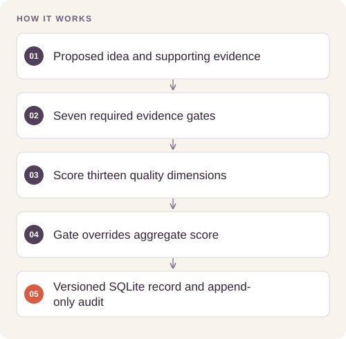

# Editorial Evidence Workflow

**Feras Elghandour**

Maintain a content-research queue without turning popularity scores, missing metrics, or unsupported claims into automatic editorial approval.

## Implementation

A standard-library SQLite application with three source streams, seven qualification gates, thirteen scored dimensions, optimistic revisions, append-only history, preserved performance snapshots, and explicit editorial queue order. A companion calculator handles complete calendar windows and comparable-post baselines.



## Try a small example

A small offline fixture exercises the public implementation. It demonstrates the behavior shown below; it does not replace the historical dataset, benchmark or production validation.

After the local setup below, run from the repository root:

```sh
python examples/quickstart.py
```

The [example source](examples/quickstart.py), [captured output](examples/expected-output.txt) and [execution record](examples/environment.json) keep this demonstration inspectable. Floating-point values may vary with library versions.

Observed output from this run:

```text
{'id': 'FWR-20260927-01', 'status': 'Qualified', 'revision': 1, 'score_total': 17, 'audit': {'ok': True, 'errors': [], 'ideas': 1, 'streams': {'Creator Radar': 1, 'Feras Originals': 0, 'Current Research & Events': 0}, 'statuses': {'Raw': 0, 'Researching': 0, 'Qualified': 1, 'Production Queue': 0, 'Scripted': 0, 'Recorded': 0, 'Published': 0, 'Reviewed': 0, 'Reuse': 0, 'Expand': 0, 'Retire': 0}, 'production_queue_size': 0, 'performance_snapshots': 0}}
```

## Evidence and results

**21 tests pass**, covering failed-gate precedence, original contribution, source provenance, revision conflicts, immutable history, incomplete scores, missing performance values, timezone/DST windows, and duplicate-sample handling. Examples are synthetic; private research notes and account metrics are excluded.

## Run locally

Python 3.11 or later; use an isolated environment.

```sh
python -m unittest discover -s tests -v
python idea_engine.py --db local-data/demo.sqlite3 init
python idea_engine.py --db local-data/demo.sqlite3 put --file examples/qualified-idea.json --reason "Synthetic demonstration"
python idea_engine.py --db local-data/demo.sqlite3 list
python idea_engine.py --db local-data/demo.sqlite3 audit
```

A sanitized synthetic input snapshot is available in `idea-engine/initial-v2-snapshot.json`. Use the CLI help for database initialization, intake, revisions, queue selection, and performance recording. No social account, provider key, scraping, or posting action is required.

## Scope and limitations

This manages review and evidence. It does not establish audience growth, content quality, platform causality, or autonomous publishing. Scores remain editorial judgments and are constrained by explicit evidence gates.

[Validation record](VALIDATION.md) · [Inputs and applicable notices](DATA.md)
